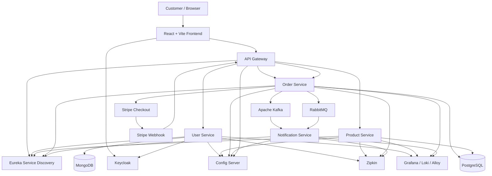

# E-Commerce Microservices Platform

A full-stack e-commerce application built using **React and Spring Boot Microservices**, with a focus on secure authentication, service discovery, centralized configuration, asynchronous communication, payment processing, containerization, and observability.

---

## Deployment and CI/CD status

**Portfolio/reference implementation; not deployed to AWS.** Infrastructure code is included to demonstrate deployment design, not to claim a verified production environment.

| Component | Repository location |
|---|---|
| Java 21 container images | Dockerfile in each of the seven backend modules |
| Kubernetes base | [deployment/kubernetes](deployment/kubernetes) |
| CPU-based HPAs | [autoscaling](deployment/kubernetes/autoscaling) |
| AWS ALB overlay | [AWS overlay](deployment/kubernetes/overlays/aws) |
| Terraform reference stack | [AWS Terraform](deployment/aws/terraform) |
| Build and manifest validation | [CI workflow](.github/workflows/ci.yml) |
| Manual ECR publishing | [CD workflow](.github/workflows/cd.yml) |

To render manifests without deploying:

```sh
kubectl kustomize deployment/kubernetes
kubectl kustomize deployment/kubernetes/overlays/aws
```

CI compiles and packages the seven Java services (existing infrastructure-dependent context tests are skipped), builds Docker images and the React frontend, renders Kustomize, and runs Terraform validation. A successful runtime integration test or production deployment is not implied.

The manually triggered CD workflow is restricted to main and publishes immutable commit-tagged images to ECR using OIDC. Configure the GitHub environment and AWS IAM role as described in [AWS deployment instructions](deployment/aws/README.md). It does not apply Terraform or deploy EKS workloads.

The Kubernetes base uses demo images and example secrets. Production use requires project-owned images, durable managed services, secure credentials and authorization, environment-specific configuration, and integration/load testing. Do not expose the reference manifests unchanged.

---

## 1. Project Overview

This project implements an e-commerce platform using a distributed microservices architecture.

The application is divided into independently responsible services rather than placing the entire business logic inside a single backend application.

### Core architecture

```text
                         CUSTOMER
                            |
                            v
                    React Frontend
                            |
                            v
                     API Gateway
                            |
          +-----------------+-----------------+
          |                 |                 |
          v                 v                 v
    User Service      Product Service    Order Service
          |                 |                 |
          v                 v                 v
     MongoDB          PostgreSQL          PostgreSQL
                            |
                            |
                    +-------+-------+
                    |               |
                    v               v
                  Kafka         RabbitMQ
                    |               |
                    +-------+-------+
                            |
                            v
                  Notification Service
```

The platform also contains infrastructure services for:

- service discovery
- centralized configuration
- authentication and authorization
- distributed messaging
- payment processing
- tracing
- centralized logging
- container orchestration for local development

---

# 2. High-Level Architecture



### Main request path

```text
Browser
   |
   v
React Frontend
   |
   v
API Gateway
   |
   +-------------------+
   |        |          |
   v        v          v
 User    Product      Order
Service  Service     Service
   |        |          |
   v        v          v
MongoDB    PostgreSQL PostgreSQL
```

The frontend communicates with the backend through the API Gateway instead of directly managing the URLs of individual microservices.

---

# 3. Why Microservices?

A traditional monolithic application might look like:

```text
                  MONOLITH
        +-------------------------+
        | User                    |
        | Product                 |
        | Cart                    |
        | Order                   |
        | Payment                 |
        | Notification            |
        |                         |
        | One application         |
        +------------+------------+
                     |
                     v
                 Database
```

This project separates these responsibilities into independent services:

```text
                 E-COMMERCE PLATFORM

       +----------------+    +----------------+
       | User Service   |    | Product Service|
       +-------+--------+    +--------+-------+
               |                      |
               v                      v
          MongoDB                  PostgreSQL

                    +----------------+
                    | Order Service  |
                    +-------+--------+
                            |
                 +----------+----------+
                 |                     |
                 v                     v
              Kafka                RabbitMQ
                 |                     |
                 +----------+----------+
                            |
                            v
                  Notification Service
```

### Benefits

Each service can have:

- a focused business responsibility
- independent deployment
- independent scaling
- independent development
- independent persistence
- independent failure boundaries

The trade-off is additional operational complexity, which is addressed through service discovery, centralized configuration, messaging, containerization, and observability.

---

# 4. Service Responsibilities

## User Service

The User Service handles user-related functionality.

Responsibilities include:

- user registration
- user information
- authentication integration
- authorization-related data
- user addresses
- Keycloak integration

```text
Client
   |
   v
Gateway
   |
   v
User Service
   |
   +----> MongoDB
   |
   +----> Keycloak
```

---

## Product Service

The Product Service manages the product catalog.

Responsibilities include:

- product creation
- product retrieval
- product updates
- product deletion
- product information

The Product Service uses PostgreSQL for persistence.

```text
Client
   |
   v
Gateway
   |
   v
Product Service
   |
   v
PostgreSQL
```

---

## Order Service

The Order Service manages the core purchasing workflow.

Responsibilities include:

- cart operations
- order creation
- checkout
- Stripe payment workflow
- payment status
- order status
- order history
- payment confirmation
- publishing order events

```text
                 Order Service
                      |
       +--------------+--------------+
       |              |              |
       v              v              v
  PostgreSQL       Stripe        Messaging
                      |
                      v
                  Webhook
```

---

## Notification Service

The Notification Service processes asynchronous events and handles notification-related functionality.

Instead of making the Order Service wait for notification processing, the order event can be published asynchronously.

```text
Order Service
      |
      v
   Event Bus
      |
      v
Notification Service
```

This reduces direct coupling between services.

---

# 5. API Gateway

The API Gateway acts as the external entry point to the backend.

```text
                         INTERNET
                            |
                            v
                    +---------------+
                    | API Gateway   |
                    +-------+-------+
                            |
              +-------------+-------------+
              |             |             |
              v             v             v
         User Service  Product Service Order Service
```

The Gateway handles concerns such as:

- request routing
- authentication/security integration
- request forwarding
- service discovery integration
- path rewriting

Example:

```text
/api/products/**
        |
        v
    API Gateway
        |
        v
Product Service
```

and:

```text
/api/orders/**
        |
        v
    API Gateway
        |
        v
Order Service
```

The frontend therefore has a single backend entry point.

---

# 6. Eureka Service Discovery

Microservices should avoid depending on hard-coded service IP addresses.

Eureka provides service registration and discovery.

```text
             Eureka Server
                  ^
                  |
        +---------+---------+
        |         |         |
        v         v         v
      User     Product     Order
     Service    Service    Service
```

Each service registers itself with Eureka.

When another service needs to locate a service, it can discover it through its registered service name.

```text
Order Service
     |
     | "Where is PRODUCT-SERVICE?"
     v
   Eureka
     |
     | Service location
     v
Product Service
```

This becomes particularly useful when service instances are scaled.

---

# 7. Config Server

Spring Cloud Config Server provides centralized configuration.

Instead of maintaining all configuration independently:

```text
User Service       ----\
Product Service    -----\
Order Service      ------> Config Server
Notification       -----/
Gateway             ----/
```

The architecture becomes:

```text
                    Config Server
                   /      |      \
                  /       |       \
                 v        v        v
              User     Product    Order
             Service    Service   Service
```

### Benefits

- centralized configuration
- environment-specific configuration
- reduced configuration duplication
- easier deployment configuration
- separation of application code and environment configuration

Sensitive values are supplied through environment variables rather than committed as secrets.

---

# 8. Authentication and Authorization

Keycloak is used for identity and access management.

The authentication flow is:

```text
Browser
   |
   | Login
   v
Keycloak
   |
   | Access Token / JWT
   v
React Application
   |
   | Bearer Token
   v
API Gateway
   |
   v
Backend Services
```

The JWT contains claims that can be used by backend services to establish the authenticated identity and authorities.

This centralizes authentication instead of implementing authentication separately in every service.

---

# 9. OAuth 2.0 / PKCE Flow

The frontend uses an authorization-code based authentication flow with PKCE.

```text
+--------+                         +----------+
| Browser|                         | Keycloak |
+---+----+                         +----+-----+
    |                                    |
    | 1. Authorization Request           |
    +----------------------------------->|
    |                                    |
    | 2. User Login                      |
    |<-----------------------------------+
    |                                    |
    | 3. Authorization Code              |
    |<-----------------------------------+
    |                                    |
    | 4. Code + PKCE Verifier            |
    +----------------------------------->|
    |                                    |
    | 5. Access Token                    |
    |<-----------------------------------+
    |                                    |
    | 6. API Request + Bearer JWT        |
    +-------------------> API Gateway   |
```

PKCE protects the authorization-code flow for public clients such as browser applications.

---

# 10. Stripe Payment Architecture

Payment processing is built around Stripe Checkout and server-side webhook processing.

The frontend does not directly decide whether an order is paid.

```text
Customer
   |
   v
React Frontend
   |
   v
Order Service
   |
   v
Stripe Checkout
   |
   | Customer completes payment
   v
Stripe
   |
   | Signed webhook
   v
/orders/webhook (Gateway)
   |
   v
Order Service
   |
   +----> Verify Stripe signature
   |
   +----> Verify payment status
   |
   +----> Confirm order
   |
   +----> Mark payment as PAID
   |
   +----> Publish order event
```

This keeps payment confirmation on the trusted server side.

---

# 11. Stripe Webhook Security

The webhook endpoint must be publicly reachable by Stripe, but it must not blindly trust incoming requests.

Stripe's signature is verified before processing the event.

```text
Stripe
   |
   | Payload + Stripe-Signature
   v
Webhook Endpoint
   |
   v
Signature Verification
   |
   +---- Invalid
   |       |
   |       v
   |      Reject
   |
   +---- Valid
           |
           v
       Process Event
```

The backend verifies:

1. webhook secret is configured
2. Stripe-Signature exists
3. Stripe signature is valid
4. event type is relevant
5. Checkout Session can be deserialized
6. payment status is actually paid
7. corresponding order can be located
8. order state can be safely updated

This prevents an attacker from simply sending a fake payment-success request.

---

# 12. Order State and Payment State

Order status and payment status represent different aspects of the transaction.

### Order lifecycle

```text
PENDING
   |
   | Payment successfully verified
   v
CONFIRMED
```

### Payment lifecycle

```text
PENDING
   |
   | Stripe confirms payment
   v
PAID
```

The Order stores Stripe payment information such as:

```text
Order
  |
  +---- Stripe Session ID
  |
  +---- Payment Intent ID
  |
  +---- Payment Status
```

This allows the application to correlate the local order with the Stripe payment.

---

# 13. Why Use a Webhook Instead of Frontend Confirmation?

A weak implementation would trust the browser:

```text
Frontend
   |
   | "Payment succeeded"
   v
Backend
   |
   v
Mark order as paid
```

The browser is not a trusted payment authority.

The stronger design is:

```text
Stripe
   |
   | Signed event
   v
Backend
   |
   | Verify
   v
Update Order
```

The frontend success page only reads the resulting order state.

This protects the payment workflow from client-side manipulation.

---

# 14. Checkout Confirmation Flow

After the customer returns from Stripe Checkout:

```text
React
  |
  | GET /orders/by-session
  v
Order Service
  |
  | Order PENDING?
  |
  +---- YES ----> Poll again
  |
  +---- NO -----> Read current order state
                       |
                       v
                  CONFIRMED
                       |
                       v
                 Show success
```

This handles the timing difference between:

```text
Customer payment completed
        |
        v
Stripe generated webhook
        |
        v
Backend received webhook
        |
        v
Backend processed payment
        |
        v
Frontend reads order state
```

The webhook and frontend redirect do not necessarily happen at exactly the same time.

---

# 15. Kafka

Apache Kafka is used for event-driven communication.

A simplified flow is:

```text
Order Service
      |
      | Order Created Event
      v
   Kafka Topic
      |
      +----------------+
      |                |
      v                v
 Consumer A         Consumer B
```

Kafka allows producers to publish events without tightly coupling themselves to individual consumers.

Example:

```text
Order Service
     |
     | order-created
     v
Kafka
     |
     v
Notification Service
```

The Order Service does not need to directly call the Notification Service for every event.

---

# 16. Kafka Consumer Groups

Kafka consumer groups allow multiple consumers to coordinate processing.

```text
Topic
+----+----+----+----+
| P0 | P1 | P2 | P3 |
+----+----+----+----+

Consumer Group
   |
   +--- Consumer 1 -> P0
   +--- Consumer 2 -> P1
   +--- Consumer 3 -> P2
   +--- Consumer 4 -> P3
```

Partitions allow Kafka to distribute processing across consumers.

This enables horizontal scaling of event consumers.

---

# 17. RabbitMQ

RabbitMQ provides queue-based asynchronous communication.

```text
Producer
   |
   v
Exchange
   |
   | Routing Key
   v
Queue
   |
   v
Consumer
```

Example:

```text
Order Service
     |
     v
order.exchange
     |
     | order.created
     v
order.queue
     |
     v
Notification Service
```

RabbitMQ allows messages to be routed through exchanges and queues before being processed by consumers.

---

# 18. Kafka vs RabbitMQ

| Kafka | RabbitMQ |
|---|---|
| Distributed event streaming platform | Message broker |
| Partition-based | Queue/exchange-based |
| Excellent for event streams | Excellent for task/message delivery |
| Consumer groups | Competing consumers |
| Strong replay capabilities | Queue-oriented consumption |
| High-throughput workloads | Flexible routing |
| Log-oriented model | Broker-oriented model |

The project demonstrates both event-streaming and queue-based messaging patterns.

---

# 19. Database Architecture

Different services use databases based on their domain requirements.

```text
User Service
     |
     v
MongoDB

Order Service
     |
     v
PostgreSQL

Product Service
     |
     v
PostgreSQL
```

This follows the database-per-service ownership principle.

A service should primarily own the data it is responsible for rather than allowing unrelated services to directly modify its database.

---

# 20. Why PostgreSQL + MongoDB?

### PostgreSQL

Used for transactional relational data such as:

- products
- orders
- order relationships
- payment information

### MongoDB

Used for document-oriented user profiles and addresses.

```text
Relational Business Data
        |
        v
   PostgreSQL

Document-Oriented Profiles
        |
        v
     MongoDB
```

This demonstrates polyglot persistence.

---

# 21. Concurrency and Optimistic Locking

Distributed applications can have multiple requests attempting to modify the same entity.

For example:

```text
Request A ----+
              |
              v
           Order #36
              ^
              |
Request B ----+
```

Optimistic locking can detect conflicting updates.

```text
Database row
version = 5

Request A reads version 5
Request B reads version 5

Request A updates
      |
      v
version = 6

Request B attempts update using version 5
      |
      v
Conflict detected
```

This is particularly important in payment and order workflows where duplicate processing could otherwise cause inconsistent state or repeated side effects.

---

# 22. Event-Driven Order Processing

The complete payment/order event flow is:

```text
                    CUSTOMER
                       |
                       v
                  React App
                       |
                       v
                 API Gateway
                       |
                       v
                 Order Service
                       |
                Create Checkout
                       |
                       v
                Stripe Checkout
                       |
                       v
                 Customer Pays
                       |
                       v
                Stripe Webhook
                       |
                       v
            Verify Signature
                       |
                       v
              Verify Payment
                       |
                       v
              Update Order
                       |
                       v
              Publish Event
                 /        \
                v          v
             Kafka      RabbitMQ
                \          /
                 \        /
                  v      v
              Notification
                 Service
```

This combines synchronous API calls with asynchronous event processing.

---

# 23. Docker Architecture

The application infrastructure is containerized using Docker Compose.

```text
                 Docker Compose
                       |
    +------------------+------------------+
    |         |        |       |         |
    v         v        v       v         v
PostgreSQL MongoDB  Kafka  RabbitMQ  Keycloak
    |
    +------------------+
                       |
                  Application
                   Services
```

Containerization provides:

- reproducible environments
- isolated dependencies
- consistent service networking
- simpler local setup
- easier deployment

---

# 24. Docker Networking

Inside Docker Compose, services communicate using Docker service names.

For example:

```text
order-service
      |
      | kafka:29092
      v
    kafka
```

An important distinction is:

```text
Inside a container:

localhost
   =
the current container
```

Whereas:

```text
kafka
   =
the Kafka container/service
```

This distinction is essential when debugging containerized applications.

---

# 25. Kafka Listener Architecture

Kafka is configured with separate internal and external listeners.

```text
                  Kafka
             +-------------+
             |             |
             | INTERNAL    |---- kafka:29092
             |             |
             | EXTERNAL    |---- localhost:9092
             +-------------+
```

Containers communicate using:

```text
kafka:29092
```

Host-based tools can communicate using:

```text
localhost:9092
```

This prevents containers from incorrectly attempting to reach Kafka through their own `localhost`.

---

# 26. Observability

Distributed applications are difficult to debug when each service operates as a black box.

The project includes observability tooling.

```text
                Microservices
                     |
        +------------+------------+
        |            |            |
        v            v            v
      Logs        Traces       Metrics
        |            |            |
        v            v            v
      Loki         Zipkin      Grafana
        \            |            /
         \           |           /
          +----------+----------+
                     |
                     v
              Observability
                 Dashboard
```

Observability helps answer questions such as:

- Which service failed?
- Where did a request spend time?
- Did the Gateway receive the request?
- Did the Order Service call another service?
- Was an event published?
- Did a webhook reach the backend?
- What error occurred?

---

# 27. Repository Structure

```text
ecom-microservices-main/
│
├── backend/
│   │
│   ├── configserver/
│   ├── eureka/
│   ├── gateway/
│   ├── notification/
│   ├── order/
│   ├── product/
│   ├── user/
│   │
│   └── deploy/
│       └── docker/
│
├── frontend/
│   │
│   ├── public/
│   ├── src/
│   ├── package.json
│   ├── package-lock.json
│   └── vite.config.js
│
├── deployment/
│   ├── kubernetes/
│   └── aws/terraform/
├── .github/workflows/
├── .gitignore
└── README.md
```

---

# 28. Local Development

## Backend prerequisites

Recommended:

- Java 21
- Maven
- Docker Desktop
- Git

## Frontend prerequisites

- Node.js
- npm

## Start backend infrastructure

Navigate to:

```text
backend/deploy/docker
```

Start the Docker Compose stack:

```powershell
docker compose up -d
```

Check running containers:

```powershell
docker compose ps
```

Stop the stack:

```powershell
docker compose down
```

---

# 29. Frontend Development

Navigate to the frontend directory:

```powershell
cd frontend
```

Install dependencies:

```powershell
npm install
```

Start the Vite development server:

```powershell
npm run dev
```

The frontend normally runs at:

```text
http://localhost:5173
```

The frontend communicates with the backend through the API Gateway.

---

# 30. Backend Development

The backend contains independently buildable Spring Boot services.

```text
Config Server
     |
     v
Eureka
     |
     v
Gateway
     |
     +---- User Service
     |
     +---- Product Service
     |
     +---- Order Service
     |
     +---- Notification Service
```

The complete Docker Compose environment is recommended for local development because the application depends on multiple infrastructure components such as:

- PostgreSQL
- MongoDB
- Kafka
- RabbitMQ
- Keycloak
- Zipkin
- Grafana/Loki/Alloy

---

# 31. Environment Variables and Secrets

Secrets should never be committed to Git.

Sensitive values can include:

```text
Database passwords
Keycloak credentials
Stripe API secrets
Stripe webhook secrets
OAuth client secrets
```

Environment variables are used for sensitive deployment configuration.

Example:

```yaml
password: ${KEYCLOAK_ADMIN_PASSWORD:user}
```

The value after `:` is a development fallback.

For real deployments, the environment variable should be supplied explicitly.

---

# 32. Security Principles

The project follows several important security principles.

### Never trust the frontend

The frontend is treated as an untrusted client.

### Validate authentication server-side

The API Gateway validates access tokens. Downstream identity propagation and authorization must be reviewed before production exposure.

### Verify Stripe webhooks

Payment confirmation is based on a cryptographically signed Stripe webhook.

### Do not commit secrets

Environment files and sensitive configuration are excluded from Git.

### Protect internal infrastructure

Databases, Kafka, RabbitMQ, Keycloak, Eureka, and Config Server should not be exposed publicly without an explicit security requirement.

---

# 33. API Request Architecture

A normal authenticated request looks like:

```text
React
  |
  | Authorization: Bearer <JWT>
  |
  v
API Gateway
  |
  | Validate / Route
  v
Microservice
  |
  v
Database
```

An asynchronous operation looks like:

```text
Microservice
    |
    | Publish Event
    v
Message Broker
    |
    v
Consumer Service
```

The system therefore uses both synchronous and asynchronous communication depending on the requirement.

---

# 34. Failure Scenarios Considered

Distributed systems must be designed with failures in mind.

### Service unavailable

```text
Gateway
   |
   v
Service unavailable
   |
   v
Request fails
```

### Kafka temporarily unavailable

```text
Order Service
      |
      v
Kafka unavailable
      |
      v
Event processing affected
```

### Duplicate webhook

```text
Stripe
   |
   +---- Webhook A
   |
   +---- Webhook B
            |
            v
      Order Service
            |
            v
   Avoid duplicate side effects
```

### Frontend returns before webhook processing

```text
Payment completed
       |
       v
Frontend returns
       |
       v
Order still PENDING
       |
       v
Webhook processed
       |
       v
Order becomes CONFIRMED
       |
       v
Frontend reads updated state
```

These scenarios demonstrate why distributed systems require careful handling of timing, failures, retries, concurrency, and duplicate events.

---

# 35. End-to-End Order Flow

A complete purchase flow can be visualized as:

```text
1. User logs into Keycloak
          |
2. React receives access token
          |
3. User adds products to cart
          |
4. React calls API Gateway
          |
5. Gateway routes request
          |
6. Order Service creates checkout session
          |
7. Stripe Checkout opens
          |
8. Customer completes payment
          |
9. Stripe sends signed webhook
          |
10. Order Service verifies webhook
          |
11. Backend verifies payment status
          |
12. Order becomes CONFIRMED
          |
13. Payment becomes PAID
          |
14. Order event is published
          |
15. Notification Service consumes event
          |
16. Frontend reads confirmed order
```

The important design principle is that payment confirmation happens on the backend through Stripe's verified webhook, while the frontend is responsible for presenting the resulting order state.

---

# Technology Stack

## Frontend

- React
- Vite
- JavaScript
- Keycloak authentication

## Backend

- Java
- Spring Boot
- Spring Cloud
- Spring Cloud Gateway
- Spring Cloud Config
- Eureka

## Databases

- PostgreSQL
- MongoDB

## Messaging

- Apache Kafka
- RabbitMQ

## Security

- Keycloak
- OAuth 2.0
- JWT
- PKCE

## Payments

- Stripe Checkout
- Stripe Webhooks

## Infrastructure

- Docker
- Docker Compose
- Kubernetes and Kustomize
- Horizontal Pod Autoscaling
- Terraform (AWS reference configuration)
- GitHub Actions

## Observability

- Zipkin
- Grafana
- Loki
- Alloy
