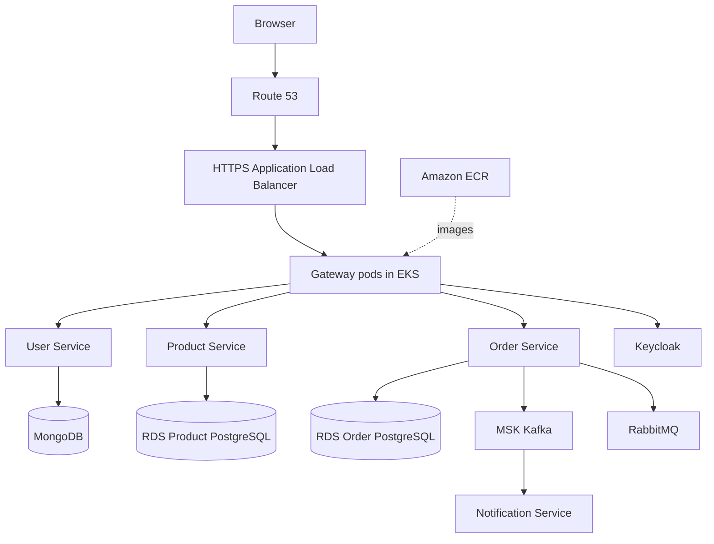

# AWS Deployment Architecture

**Status: reference implementation, not deployed or production validated.** Do not apply the example infrastructure unchanged.

## Repository components

- [Terraform](terraform): VPC, EKS, RDS, ECR, MSK and optional DNS alias.
- [AWS overlay](kubernetes): ALB Ingress, HTTPS redirect, limited public API paths and a ClusterIP gateway service.
- [Autoscaling](../kubernetes/autoscaling): CPU-based HPAs; Metrics Server required.
- [CI](../../.github/workflows/ci.yml): compilation, container/frontend builds, manifest rendering and Terraform validation. Existing infrastructure-dependent tests are not executed.
- [CD](../../.github/workflows/cd.yml): manual ECR image publication only.

## Manual ECR delivery prerequisites

Create the GitHub environment `aws-publish` with required reviewers and main-only deployment protection. Set its variables `AWS_ECR_ROLE_ARN`, `AWS_REGION` and `ECR_PROJECT` (matching the Terraform project). Configure an AWS GitHub OIDC provider and a least-privilege publishing role with trust restricted to this repository's `aws-publish` environment, including the audience `sts.amazonaws.com`. Grant ECR authorization and push/describe permissions only as needed for the intended repositories. No long-lived AWS keys are required. ECR repositories must already exist.

The workflow publishes images tagged with the commit SHA. It does not install infrastructure or roll out Kubernetes deployments.

## Validation and deployment prerequisites

Render both Kustomize configurations locally, validate Terraform, and review CI results before merging. The Terraform README explains required inputs, costs and integration gaps. Before any real deployment, configure the AWS Load Balancer Controller, Metrics Server, ACM, domain, workload IAM, secure Keycloak issuer, ECR image references, managed database and Kafka client configuration, durable MongoDB/RabbitMQ and secrets. Review authorization, concurrent checkout/webhook processing, and perform end-to-end tests.

No AWS resources were provisioned by these repository changes.
